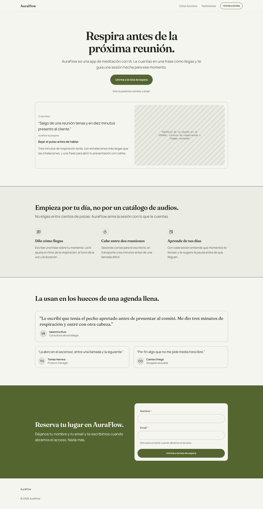
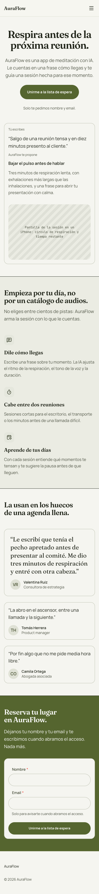
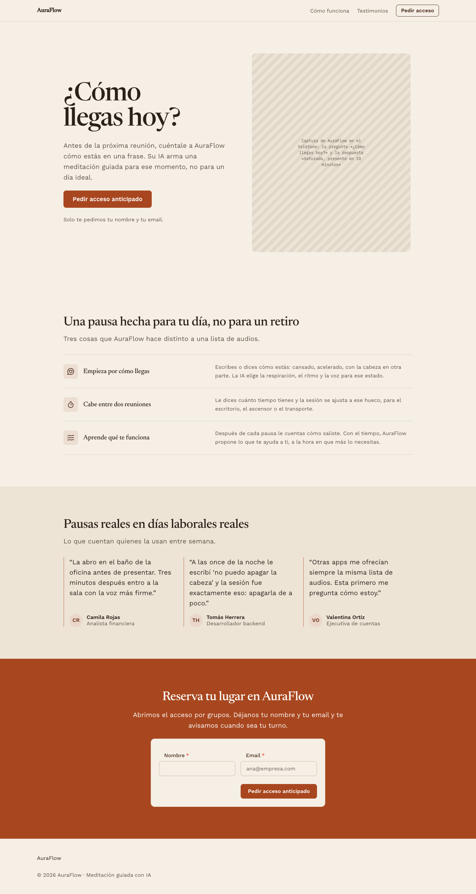
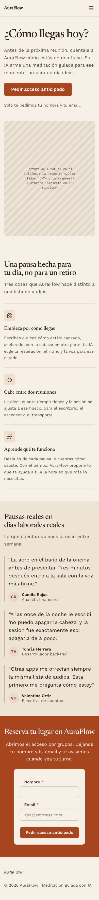

# AuraFlow landing

[Examples](../README.md) · [Documentation](../../README.md)

Public page. The brief, pasted as is into a Claude Code session with the `neus-design` skill (it is in Spanish, like the pages):

```text
Una landing page minimalista y moderna para una startup llamada 'AuraFlow', una app de meditación con IA, dirigida a jóvenes profesionales estresados.
Deberá contener una sección Hero con llamado a la acción (CTA) principal, tres características clave con iconos, testimonios de usuarios y un formulario de registro simple.
```

In English: A minimal, modern landing page for AuraFlow, an AI meditation app for stressed young professionals: a hero with the main call to action, three key features with icons, user testimonials and a simple signup form.

## On a built-in system, with a brand

Neus with the brand *Salvia y papel*: moss `#55652F` actions, warm white ground, Fraunces headlines.

| Desktop (1440 px) | Phone (390 px) |
| --- | --- |
|  |  |

Centered hero with a demo card and a picture placeholder, feature grid with icon tiles, featured testimonial cards, signup form on a brand band.

Set up with `npx neus init --yes --system neus`, then the skill asked for a brand and applied it with `npx neus init --primary … --brand …` and a block of tokens in `src/styles/neus.overrides.css`. Code in [`brand/`](./brand/): `neus.config.json`, `index.html` (fonts), `src/` (the page, `src/neus/` root and theme, `src/styles/neus.overrides.css`) and `design/specs/` when the session wrote a spec.

## With a derived system (None mode)

Derived system *AuraFlow Sand* on Neus: sand ground, terracotta `#A8471F` actions, Newsreader headlines over Work Sans, 8 and 12 px shapes.

| Desktop (1440 px) | Phone (390 px) |
| --- | --- |
|  |  |

Split hero with a phone placeholder, features as a specification list, plain quotes with a rule, signup card on a brand band.

Set up with `npx neus init --yes --system none`, then the skill derived `design/system/DESIGN.md`, compiled it with `npx neus design build` into `src/styles/neus.system.css` and set the palette with `npx neus init --base … --primary …`. Code in [`derived/`](./derived/): `neus.config.json`, `index.html` (fonts), `design/system/DESIGN.md` (the derived system), `src/styles/neus.system.css` (compiled), `src/` and `design/specs/` when the session wrote a spec.
