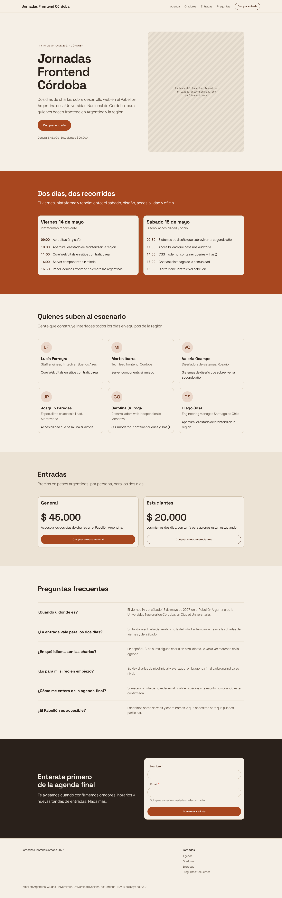
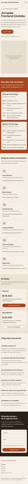
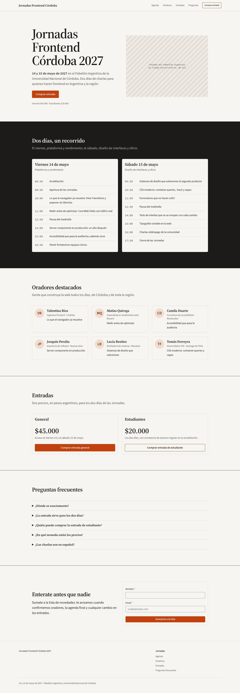
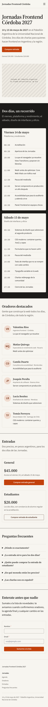

# Jornadas Frontend Córdoba 2027

[Examples](../README.md) · [Documentation](../../README.md)

Public page. The brief, pasted as is into a Claude Code session with the `neus-design` skill (it is in Spanish, like the pages):

```text
Una landing para 'Jornadas Frontend Córdoba 2027', una conferencia de desarrollo web de dos días, el 14 y 15 de mayo de 2027, en el Pabellón Argentina de la Universidad Nacional de Córdoba, dirigida a desarrolladores frontend de Argentina y la región.
Debe incluir un hero con la fecha, el lugar y un CTA para comprar entradas, la agenda resumida de los dos días, los oradores destacados, los precios de las entradas (General $45.000 y Estudiantes $20.000, en pesos argentinos), preguntas frecuentes y un formulario para sumarse a la lista de novedades.
```

In English: A landing page for a two-day frontend conference in Córdoba, Argentina, on May 14 and 15, 2027, at the Pabellón Argentina: a hero with the date, the venue and a ticket call to action, the agenda of both days, the featured speakers, ticket prices (General ARS 45,000, Students ARS 20,000), FAQ and a newsletter signup form.

## On a built-in system, with a brand

Neus with the brand *Ladrillo de la Docta*: terracotta `#A8471F`, warm sand ground, Space Grotesk.

| Desktop (1440 px) | Phone (390 px) |
| --- | --- |
|  |  |

Split hero with a venue picture placeholder, agenda on a brand band, speaker cards with avatars, price cards, FAQ, signup on an inverse band.

Set up with `npx neus init --yes --system neus`, then the skill asked for a brand and applied it with `npx neus init --primary … --brand …` and a block of tokens in `src/styles/neus.overrides.css`. Code in [`brand/`](./brand/): `neus.config.json`, `index.html` (fonts), `src/` (the page, `src/neus/` root and theme, `src/styles/neus.overrides.css`) and `design/specs/` when the session wrote a spec.

## With a derived system (None mode)

Derived system *Programa* on Vercel: paper ground, ink rules, signal orange `#C2410C` and a printed-programme serif (Source Serif 4).

| Desktop (1440 px) | Phone (390 px) |
| --- | --- |
|  |  |

Programme-like agenda on an inverse band, speaker cards, price cards with inset actions, FAQ and the signup form.

Set up with `npx neus init --yes --system none`, then the skill derived `design/system/DESIGN.md`, compiled it with `npx neus design build` into `src/styles/neus.system.css` and set the palette with `npx neus init --base … --primary …`. Code in [`derived/`](./derived/): `neus.config.json`, `index.html` (fonts), `design/system/DESIGN.md` (the derived system), `src/styles/neus.system.css` (compiled), `src/` and `design/specs/` when the session wrote a spec.
