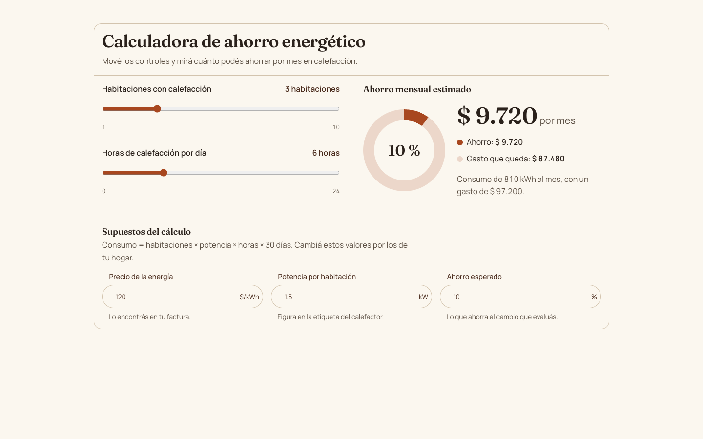
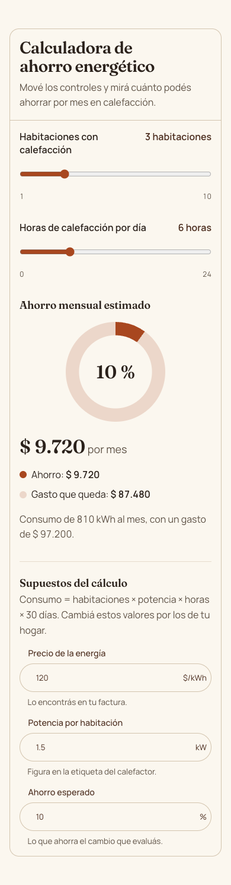
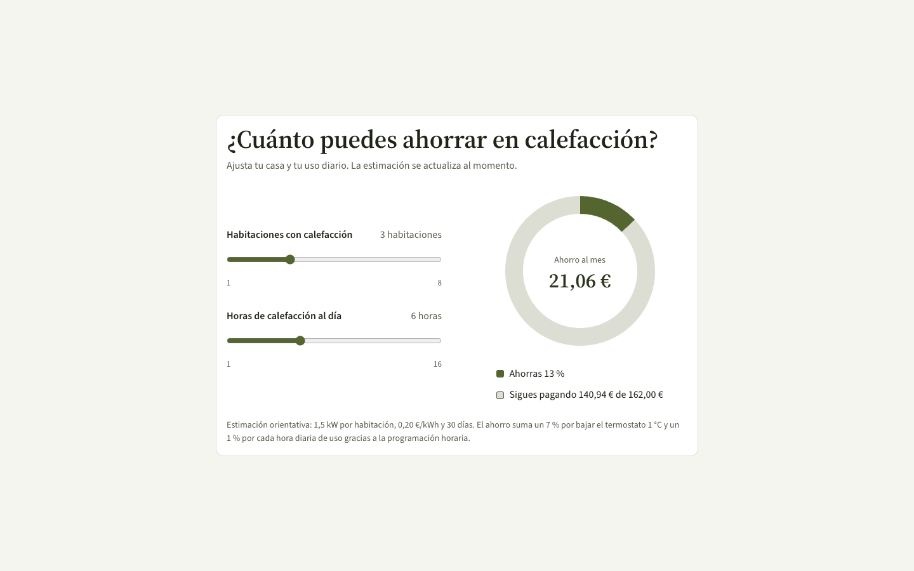
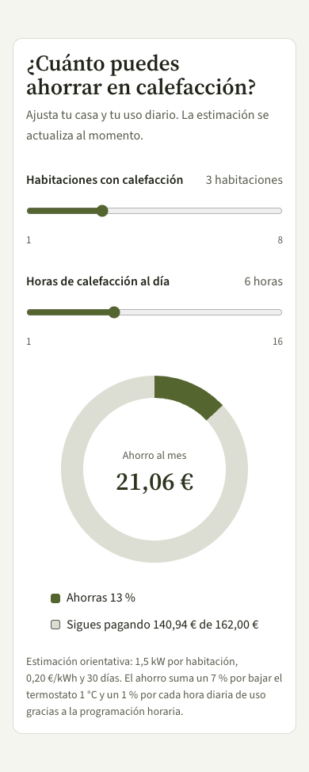

# Home energy savings calculator

[Examples](../README.md) · [Documentation](../../README.md)

App widget. The brief, pasted as is into a Claude Code session with the `neus-design` skill (it is in Spanish, like the pages):

```text
Diseña un widget interactivo de 'Calculadora de Ahorro Energético para el Hogar'.
El usuario puede mover dos sliders (número de habitaciones y horas de uso de calefacción) y ver en tiempo real una estimación de ahorro mensual con un gráfico circular simple.
```

In English: An interactive home energy savings calculator: two sliders (number of rooms and daily heating hours) update a monthly savings estimate and a simple donut chart in real time.

## On a built-in system, with a brand

Neus with the brand *Hogar cálido*: terracotta `#A8471F`, cream ground, Fraunces.

| Desktop (1440 px) | Phone (390 px) |
| --- | --- |
|  |  |

Sliders beside the donut and the estimate, editable assumptions with hints under the result.

Set up with `npx neus init --yes --system neus`, then the skill asked for a brand and applied it with `npx neus init --primary … --brand …` and a block of tokens in `src/styles/neus.overrides.css`. Code in [`brand/`](./brand/): `neus.config.json`, `index.html` (fonts), `src/` (the page, `src/neus/` root and theme, `src/styles/neus.overrides.css`) and `design/specs/` when the session wrote a spec.

## With a derived system (None mode)

Derived system *Musgo* on Apple: moss `#55652F` accent, editorial serif headings on a humanist sans, soft corners and hairline depth.

| Desktop (1440 px) | Phone (390 px) |
| --- | --- |
|  |  |

One card with the sliders, a labelled donut, the legend and the stated assumptions.

Set up with `npx neus init --yes --system none`, then the skill derived `design/system/DESIGN.md`, compiled it with `npx neus design build` into `src/styles/neus.system.css` and set the palette with `npx neus init --base … --primary …`. Code in [`derived/`](./derived/): `neus.config.json`, `index.html` (fonts), `design/system/DESIGN.md` (the derived system), `src/styles/neus.system.css` (compiled), `src/` and `design/specs/` when the session wrote a spec.
