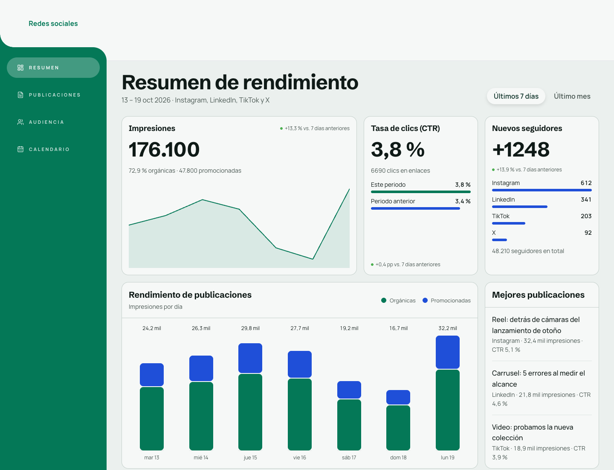
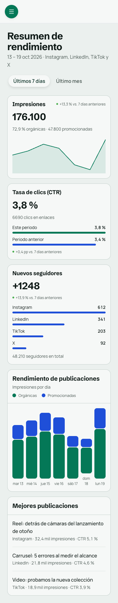
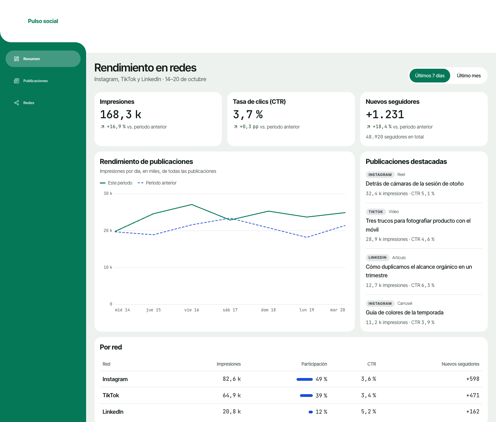
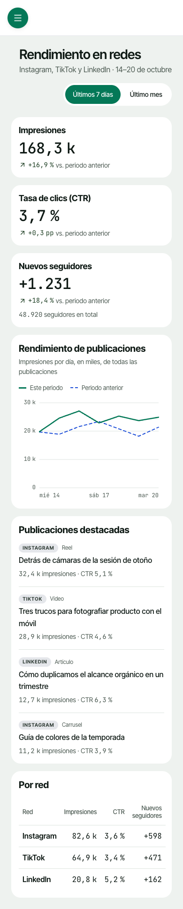

# Social media dashboard

[Examples](../README.md) · [Documentation](../../README.md)

App screen. The brief, pasted as is into a Claude Code session with the `neus-design` skill (it is in Spanish, like the pages):

```text
Crea un dashboard analítico para un gestor de redes sociales.
Muestra métricas clave como: impresiones semanales, tasa de clics (CTR), crecimiento de seguidores y gráfico de rendimiento de publicaciones.
Estilo limpio tipo 'bento grid' con tarjetas redondeadas, colores de acento en verde esmeralda y azul, con modo claro por defecto.
Añade pestañas simuladas para cambiar entre vistas de 'Últimos 7 días' y 'Último mes'.
```

In English: An analytics dashboard for a social media manager with weekly impressions, click-through rate, follower growth and a post performance chart, in a clean bento grid with rounded cards, emerald and blue accents, light mode by default, and tabs for the last 7 days and the last month.

## On a built-in system, with a brand

Neus with the brand *Esmeralda analítico*: emerald `#047857` actions, blue for data, cool white ground, Schibsted Grotesk display.

| Desktop (1440 px) | Phone (390 px) |
| --- | --- |
|  |  |

AppTemplate shell, KPI cards with per-network bars, stacked daily bars, top posts list.

Set up with `npx neus init --yes --system neus`, then the skill asked for a brand and applied it with `npx neus init --primary … --brand …` and a block of tokens in `src/styles/neus.overrides.css`. Code in [`brand/`](./brand/): `neus.config.json`, `index.html` (fonts), `src/` (the page, `src/neus/` root and theme, `src/styles/neus.overrides.css`) and `design/specs/` when the session wrote a spec.

## With a derived system (None mode)

Derived system *Bento tonal* on Neus: emerald actions, blue data accent, green-gray ground, Inter Tight with monospaced figures.

| Desktop (1440 px) | Phone (390 px) |
| --- | --- |
|  |  |

AppTemplate shell with the solid sidebar, line chart with the previous period, top posts and a per-network table.

Set up with `npx neus init --yes --system none`, then the skill derived `design/system/DESIGN.md`, compiled it with `npx neus design build` into `src/styles/neus.system.css` and set the palette with `npx neus init --base … --primary …`. Code in [`derived/`](./derived/): `neus.config.json`, `index.html` (fonts), `design/system/DESIGN.md` (the derived system), `src/styles/neus.system.css` (compiled), `src/` and `design/specs/` when the session wrote a spec.
