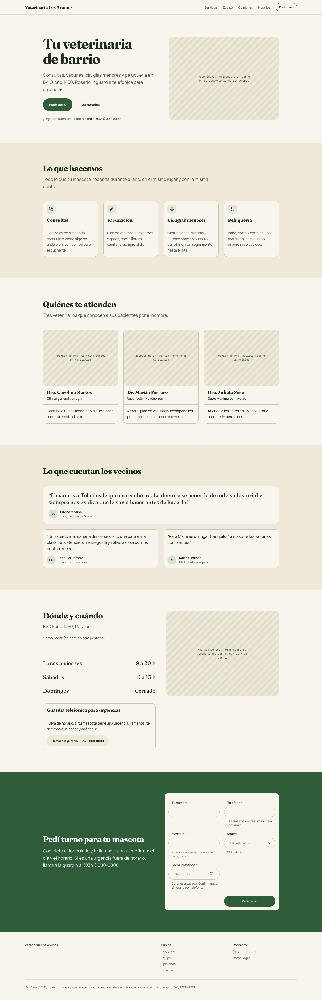
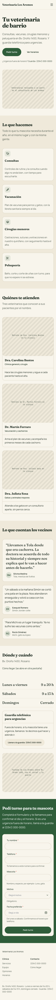
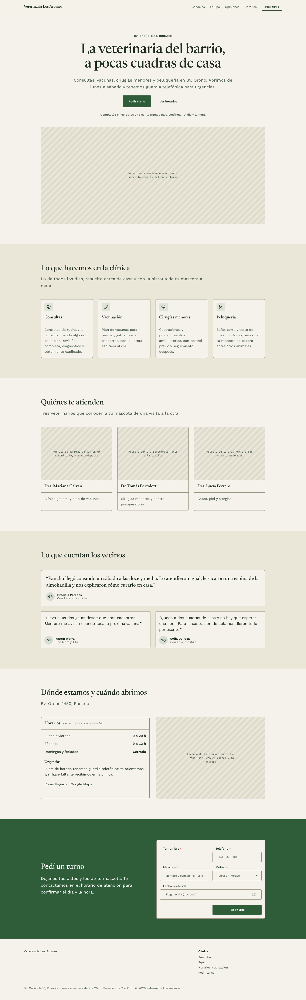
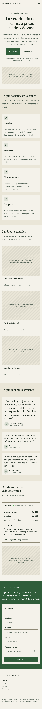

# Veterinaria Los Aromos

[Examples](../README.md) · [Documentation](../../README.md)

Public page. The brief, pasted as is into a Claude Code session with the `neus-design` skill (it is in Spanish, like the pages):

```text
Una página para 'Veterinaria Los Aromos', una clínica veterinaria de barrio en Rosario, en Bv. Oroño 1450. Atiende de lunes a viernes de 9 a 20 h y los sábados de 9 a 13 h, con guardia telefónica para urgencias.
Debe incluir un hero con un CTA para pedir turno, los servicios (consultas, vacunación, cirugías menores y peluquería), el equipo de tres veterinarios, opiniones de clientes, la ubicación con los horarios y un formulario para pedir turno con nombre, teléfono, mascota, motivo y fecha preferida.
```

In English: A page for a neighbourhood veterinary clinic in Rosario, Argentina (Bv. Oroño 1450; open Monday to Friday 9 to 20 h and Saturday 9 to 13 h, with an emergency phone line): a hero with a call to book a visit, the services (check-ups, vaccination, minor surgery and grooming), the team of three vets, client reviews, the location with the opening hours, and a booking form with name, phone, pet, reason and preferred date.

## On a built-in system, with a brand

Neus with the brand *Aromo y monte*: forest green `#2F5D3A`, warm cream, Fraunces.

| Desktop (1440 px) | Phone (390 px) |
| --- | --- |
|  |  |

Split hero with a photo placeholder, service and team cards, reviews, hours and emergency card, booking form on a brand band.

Set up with `npx neus init --yes --system neus`, then the skill asked for a brand and applied it with `npx neus init --primary … --brand …` and a block of tokens in `src/styles/neus.overrides.css`. Code in [`brand/`](./brand/): `neus.config.json`, `index.html` (fonts), `src/` (the page, `src/neus/` root and theme, `src/styles/neus.overrides.css`) and `design/specs/` when the session wrote a spec.

## With a derived system (None mode)

Derived system *Los Aromos* on Neus: forest green on cream, Newsreader over Work Sans, small radii and hard ink offsets on floating layers.

| Desktop (1440 px) | Phone (390 px) |
| --- | --- |
|  |  |

Centered hero with a wide photo placeholder, service cards, team cards with portrait placeholders, featured review cards, hours card, booking form with even rows.

Set up with `npx neus init --yes --system none`, then the skill derived `design/system/DESIGN.md`, compiled it with `npx neus design build` into `src/styles/neus.system.css` and set the palette with `npx neus init --base … --primary …`. Code in [`derived/`](./derived/): `neus.config.json`, `index.html` (fonts), `design/system/DESIGN.md` (the derived system), `src/styles/neus.system.css` (compiled), `src/` and `design/specs/` when the session wrote a spec.
